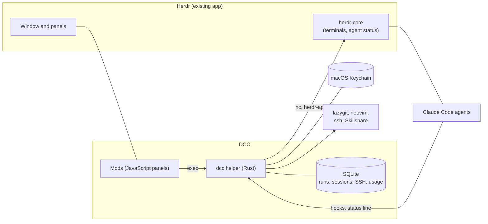

# herdr-dcc

**Developer Command Center (DCC)** is an add-on for the Herdr desktop terminal app. It puts everything a developer who works with several AI coding agents needs into one window: what each agent is doing, where it works, which servers you are connected to, your Git state and your AI tool configuration.

DCC does not replace your tools. It connects the ones that already work well (Herdr, lazygit, neovim, Skillshare, ssh) and adds the missing glue as a small Rust helper (`dcc`) and a set of Herdr panels.

> **Status.** Built and tested end to end on a throwaway Herdr copy, not yet installed into a daily-use Herdr. macOS on Apple Silicon is the target. Windows is out of scope for now. This project is independent and is not affiliated with Herdr.

## What you get

| Panel | What it does |
| --- | --- |
| **Workspaces** | Save a space (tabs, split panes, folders, startup commands), close it, restore it later, or start one from a template such as the *code* tab (neovim, lazygit, shell). |
| **Agents** | One row per AI agent session with its state (waiting, running, completed, failed, stopped), branch, worktree, changed files, last hook event and a warning when two agents share one folder. Ended sessions stay in a local history. |
| **SSH** | Profiles and groups, passwords or key passphrases kept in the macOS Keychain, one-click connect in its own tab, local, remote and dynamic port forwards you can start and stop, saved one-line commands you can send to a terminal. |
| **Code** | A lazygit popup in the folder of the focused terminal, a one-click code tab (neovim, lazygit, shell) where typing `e file` in the bottom shell opens the file in the neovim above, git facts for that folder. Checks that lazygit and neovim are installed and tells you how to install them if not. |
| **AI config** | A read-only inventory of AI tool files (skills, rules, commands, settings, memory) with paths and sizes only, and a Skillshare sync preview with backup, diff and a separate approval for removals. |
| **Usage** | Context use and account quota exactly as the agent's own status line reports them, in separate sections. No source means "Unavailable". Nothing is estimated. |

The panels open from buttons next to the `+` in the tab bar, never more than two at a time (a third replaces the one opened earlier), so terminals keep their space. Pressing the button of an open panel closes it.

## How it fits together



- Agent state comes from Herdr's own status for each terminal. Hooks and the status line only add ids and extra facts.
- Agents started by DCC carry their own settings file (`claude --settings`) with hooks that call `dcc`. DCC never writes to `~/.claude`.
- Anything that can take longer than 30 seconds runs as a detached job you can poll.

## Safety principles

- **Secrets** live only in the Keychain. They never appear in argv, files, logs or screens. There is no `secret get`. A password reaches `ssh` through a private socket and an askpass helper.
- **Config writes** (for example a Skillshare sync) need a preview you have seen, a backup first, and a separate approval to remove anything.
- **Numbers are never guessed.** Usage and quota come from the agent's status line or are shown as unavailable.
- **Read-only where possible.** Git calls disable hooks that a repository could use to run code, and the AI inventory only reads file metadata, never file content.

## Requirements

- macOS on Apple Silicon, the Herdr desktop app (tested with app 0.1.15 and core 0.1.20, pinned in `compat.toml`)
- Rust (current stable) to build
- Optional: lazygit, neovim, [Skillshare](https://skillshare.runkids.cc) and Claude Code for the matching features. DCC installs nothing for you and tells you what is missing.

## Build and test

```sh
cargo build
cargo test --workspace
cargo clippy --all-targets
```

Tests never touch a real Herdr or your real `~/.claude`. Tests that need Skillshare are skipped when it is not installed.

## Install into Herdr

Herdr keeps its settings, mods and layouts in `~/.config/herdr-app` (its app home). DCC keeps its own data (SQLite file, jobs, backups) in `~/.config/herdr-dcc`, or wherever `--data-dir` or `DCC_DATA_DIR` points. All `dcc` commands print JSON, see `dcc --help`.

```sh
dcc herdr install             # dry run: shows what would be created or replaced, writes nothing
dcc herdr install --apply     # backs up every file it replaces, then installs
dcc herdr uninstall --backup <id>             # lists what an undo would do
dcc herdr uninstall --backup <id> --confirm   # removes what the install created, restores what it replaced
```

What an install does and does not do.

- It writes only the DCC mods (`mods/dcc-*`) and the DCC layout (`layouts/dcc.json`) into the app home. Your Herdr settings, other mods and other layouts are not touched.
- Before writing it copies each file it is about to replace into `<data folder>/backups/<id>/` with a manifest. If a backup fails, nothing is written.
- Every DCC mod is marked `place: none` in its `mod.json`. Herdr docks a new mod into the layout that happens to be shown unless it says so, which would push your terminal out of view. The DCC panels appear only in the `dcc` layout.
- It does not switch your layout. Pick `dcc` yourself (ctrl-shift-l cycles layouts), and switch back to `main` any time.
- The tab bar is derived at install time from the `tabs` mod you already have. If a Herdr update changes that file, the install stops with a clear message instead of writing a broken bar. No Herdr code is shipped in this repository.

Run `dcc` from this repository so the default `mods`, `assets` and `layouts` paths resolve, and build a release binary first (`cargo build --release`), because the panels remember the path of the `dcc` binary that installed them.

## Repository layout

```
crates/dcc                 the helper and its library
crates/dcc-fixture-agent   a fake agent used by tests
crates/xtask               development environment tasks
mods/                      Herdr panels (workspaces, agents, ssh, code, config, usage)
layouts/ assets/ templates/  layout recipe, tab icons, workspace templates
docs/                      inventory, PRD, architecture, roadmap, validation, progress log
```

## Roadmap

Phases 1 to 6 are done: core, agent panel and session record, SSH, Git and code tab, AI config, usage and quota. Windows support is a later phase. Each phase's acceptance criteria and results are in `docs/05-roadmap.md` and `docs/PROGRESS.md`, including what is still open.

## Author

Barış Gündüz

## License

No license has been chosen yet, so all rights are reserved.
