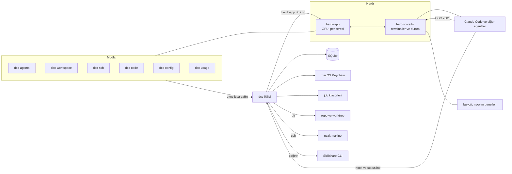

# DCC mimarisi

Sürüm 0.1, taslak. Dayanaklar spike bulguları (`~/dev/dcc-spike/SPIKE-REPORT.md`, `SPIKE-SUMMARY.md`) ve `docs/02-PRD.md`. Spike'ta denenmeyen yerler "doğrulanmadı" diye işaretlidir.

## 1. İlkeler

- Herdr'a dokunulmaz. Özellikler Herdr modları (JavaScript) ve tek bir Rust ikilisi (dcc) ile yapılır.
- Mod ince kalır. Sunum ve tetikleme modda, mantık, veri ve gizli bilgi dcc'de.
- Her dcc komutu kısa döner (hedef 2 sn altı). 30 sn'yi aşabilecek iş job desenini kullanır.
- Durum için çekirdek durumu esas alınır, hook'lar yalnızca kimlik ve ek bilgi içindir.
- Konuşma içeriği hiçbir yere yazılmaz. Yalnızca kimlik, yol, durum adı, sayı ve zaman damgası.
- Platformdan bağımsız kod. macOS'a özgü yalnızca Keychain.

## 2. Bileşenler

| Bileşen | Rol | Kaynak |
| --- | --- | --- |
| herdr-app (GPUI) | Pencere, layout, mod çalıştırma. Sürüm 0.1.15 ile ölçüldü | Herdr (değiştirilmez) |
| herdr-core (`hc`) | Terminalleri yaşatır, agent durumunu tutar. Sürüm 0.1.20 ile ölçüldü | Herdr (değiştirilmez) |
| Modlar (JavaScript) | Paneller ve komutlar. `dcc-agents`, `dcc-workspace`, `dcc-ssh`, `dcc-code`, `dcc-config`, `dcc-usage` | Biz |
| dcc (Rust) | Alt komutlar, SQLite, Keychain, git, hook ve statusline kaydı, job deseni, Herdr sarmalayıcısı | Biz |
| SQLite dosyası | Kalıcı kayıt. Veri klasöründe, app home'un dışında | Biz |
| Job klasörleri | Detached işlerin durumu (pid, heartbeat, çıktı, çıkış kodu). Mod 0700 | Biz |
| Agent'lar | Claude Code ilk hedef. OSC 7501 ile durum bildirir | Üçüncü taraf |
| Dış araçlar | lazygit, neovim, ssh, Skillshare | Üçüncü taraf |



## 3. Veri akışları

### 3.1 Agent durumu ve paneli

1. Agent OSC 7501 ile durumunu bildirir (`idle`, `working`, `blocked`, `done`, çıkışta `clear`). Core bunu terminal durumu olarak tutar.
2. `dcc-agents` modu 2 sn'de bir `panes()` ve `terminals()` verisinden kayıtları toplar ve geçici bir JSON dosyasına yazar (mod exec'inde stdin yok, spike Adım 6).
3. Mod `dcc agent snapshot --input <dosya> --record` komutunu çağırır. dcc her kayıt için git bilgisini (zaman aşımlı, kilitsiz), oturum kimliğini ve DCC durumunu hesaplar, SQLite'a yazar ve JSON döner.
4. Mod JSON'u çizer. Veri değişmediyse yeniden çizmez.
5. Panelden kaybolan terminal için dcc, kaydı `hc` ile kontrol eder (bitti, çıkış kodu, neden) ve oturumu Completed, Stopped veya Failed olarak kapatır.
6. Bir agent süreci (çalıştırma) birden çok oturum taşıyabilir. Faz 0 testinde `/clear` aynı süreçte `SessionEnd` ve yeni bir oturum kimliğiyle `SessionStart` üretti. Bu yüzden kayıt iki katmanlıdır (bölüm 5) ve argv'deki kimlik yalnızca ilk oturumu gösterir.

Spike ölçümü, snapshot 19 ile 26 ms, panel gecikmesi medyan 1,1 sn, en kötü 5,3 sn. Panelden kaybolan oturumların kaydı henüz spike'ta yoktu (Faz 2'de yapılır).

### 3.2 DCC agent'ı başlatır

1. `dcc agent launch` repo ve (istenirse) yeni bir worktree seçer. Agent başına ayrı worktree varsayılandır.
2. Oturum kimliği olarak yeni bir uuid üretir ve SQLite'a `starting` durumuyla yazar.
3. Geçici bir ayar dosyası üretir (`<veri klasörü>/agents/<kimlik>/settings.json`). Hook (SessionStart, UserPromptSubmit, PreToolUse, Notification, Stop, SessionEnd) `dcc agent hook-log` komutunu, statusLine `dcc agent statusline-log` komutunu çalıştırır.
4. Agent `hc run --bg --label herdr.space=<id> --label herdr.tab=<id> -- dcc agent exec -- claude --settings <dosya> --session-id <uuid> ...` ile açılır. Etiketler terminali Herdr sekmesine bağlar. `terminal.open` ile açılan agent shell'in içinde çalıştığı için çıkınca terminal canlı kalır ve çıkış kodu yoktur, bu yüzden bu yol kullanılmaz (Faz 0 test 4). `dcc agent exec` ortamdaki `CLAUDE*` ve `AI_AGENT` değişkenlerini temizler ve programı çalıştırır. Unix'te süreç değişimi (exec) ile, böylece Herdr'ın görünen programı agent kalır. Windows'ta doğrulanmadı.
   Doğrulanmadı. Gerçek Claude Code'un bu yolla açılması (çekirdeğin PATH ve ortamı, güven sorusu), etiketli sekmeyi almak için kullanılan boş sekmedeki shell pane'inin kapatılması.
5. Güven sorusu çıkarsa Herdr durum göstermez (spike'ta yaklaşık 132 sn). DCC satırı "Unknown, güven sorusu olabilir" gösterir ve onay vermez.

`--settings` ile hook ve statusline enjeksiyonu spike'ta denenmedi (Faz 0 test 1). Spike'ta proje düzeyi `settings.local.json` çalıştı.

### 3.3 Workspace kaydet ve geri yükle

`dcc workspace save` Herdr'dan (`herdr-app ls`, `hc ls --json`) sekmeleri, klasörleri ve pane sırasını okur, başlangıç komutlarıyla SQLite'a yazar. `restore` `herdr-app do space.new`, `tab.new`, `terminal.open {folder, place}` ve `hc send` çağırır. Aynı adlı space açıksa reddeder. Split yönü ve boyutu okunamaz, pane'ler sırayla sağa bölünür (KK-05). Space kapanırken terminaller bilerek kapatılır veya park edilir.

İki mod vardır (Faz 0 test 3).

- **Şablon.** Bizim yazdığımız bir komut ağacı. Örneğin kod sekmesi şu dizidir: `space.new` (neovim), `terminal.open down` (shell), `pane.focus` (üst pane), `terminal.open right` (lazygit). Varsayılan oranlarda aynı düzeni verdi. Özel oranlar denenmedi.
- **Anlık kayıt.** Rastgele bir workspace'in kaydı. Herdr bölme yönünü ve oranını vermediği için pane sırası ve klasörler yaklaşık kalır.

Geri yükleme de iki yoldur. Core yeniden başlayınca Herdr yapıyı, sekme adlarını ve klasörleri kendisi korur ve her terminal boş shell olur. Bu durumda dcc yalnızca programları yeniden yazar (`hc send`). Space kapatılmışsa dcc ağacı komut dizisiyle yeniden kurar. `space.close` bazen terminalleri kapatıyor bazen kapatmıyor (Faz 0 test 3 ve spike Adım 4 farklı çıktı), bu yüzden her kapanışta terminaller doğrulanır ve kapatılır.

### 3.4 Uzun işler

`dcc job start -- <komut>` ayrı süreç grubunda bir çalıştırıcı başlatır, `HC_SCOPE` değişkenini kaldırır, pid dosyasını bekler ve döner. Çalıştırıcı her saniye heartbeat yazar, çıktıyı ve çıkış kodunu (atomik) dosyaya bırakır. Mod `job status` ile 1 sn'de bir sorar. `clean` ve `sweep` klasörleri temizler. Klasör ve içerik 0700. Spike'ta 41 sn'lik iş sırasında pencere donmadı. Windows kolu (`creation_flags`) derlenmedi.

## 4. dcc komut yüzeyi

Mod yüzeyi, modun çağırmasına izin verilen komutlardır. Modlar sandbox'suz çalıştığı için bu bir güvenlik sınırı değil bir kural ve test konusudur (bölüm 11).

| Grup | Komutlar | Mod yüzeyi |
| --- | --- | --- |
| secret | `set` (yalnızca terminal), `exists`, `delete`, `use` (sırrı kendi içinde kullanan komutlar) | `exists` ve `use` evet. `get` komutu yoktur (derlemede bile bulunmaz) |
| agent | `launch`, `exec`, `hook-log`, `statusline-log`, `snapshot`, `sessions` (liste) | `snapshot`, `sessions`, `launch` evet |
| workspace | `save`, `restore`, `list` | Evet |
| ssh | `profile add/list/remove`, `connect`, `forward start/status/stop` | Evet. Sır yalnızca dcc içinde kullanılır |
| cmd | `add`, `list`, `remove`, `run` (hc send) | Evet |
| git | `info` (salt okunur), `worktree add/list/remove` | Evet. Silme ayrı onay ister |
| config | `inventory` (okuma), `plan` (dry-run), `apply` (yedekli) | Okuma ve plan evet. `apply` ayrı onay ister |
| usage | `samples` (liste) | Evet |
| job | `start`, `status`, `clean`, `sweep` | Evet |
| diag | `env`, `contract` (OSC 7501 sözleşme testi) | Evet |
| herdr | `ensure-layout`, `ensure-mods`, `core` (başlat, durdur, PID doğrula) | Evet |

Tüm okuma komutları geçersiz girdide bile geçerli JSON ve sıfır çıkış koduyla döner (hata bir alandır). Hook komutları her zaman sıfırla çıkar, Claude Code'u bloklamaz.

## 5. SQLite şeması

Tek dosya, WAL modu, 5 sn busy timeout, `PRAGMA user_version` ile numaralı göç (migration). Zaman damgaları milisaniye. Sütunlarda konuşma içeriği yoktur.

```sql
CREATE TABLE agent_runs (                    -- bir agent süreci, bir terminal
  id              TEXT PRIMARY KEY,          -- DCC'nin verdiği uuid (--session-id, ilk oturumun kimliği)
  agent_kind      TEXT NOT NULL,             -- claude, codex, ...
  launch_mode     TEXT NOT NULL,             -- dcc | external
  started_ms      INTEGER NOT NULL,
  ended_ms        INTEGER,
  last_state      TEXT NOT NULL,             -- Running|Waiting|Completed|Failed|Stopped|Unknown
  last_state_ms   INTEGER NOT NULL,
  end_reason      TEXT,                      -- exited_0 | exit_code | killed | session_end | lost
  exit_code       INTEGER,
  cwd             TEXT,
  repo_root       TEXT,
  branch          TEXT,
  worktree_kind   TEXT,                      -- main | linked
  changed_files   INTEGER,
  staged          INTEGER,
  unstaged        INTEGER,
  untracked       INTEGER,
  herdr_session   TEXT,                      -- HC_SESSION (izolasyon)
  terminal_addr   TEXT,
  pane_id         TEXT
);
CREATE INDEX agent_runs_state ON agent_runs (last_state, last_state_ms);

CREATE TABLE agent_sessions (                -- bir koşuda birden çok olabilir (/clear)
  id          TEXT PRIMARY KEY,              -- hook session_id
  run_id      TEXT NOT NULL REFERENCES agent_runs(id),
  id_source   TEXT NOT NULL,                 -- argv | hook | none
  started_ms  INTEGER NOT NULL,
  ended_ms    INTEGER,
  end_source  TEXT                           -- session_end | clear | lost
);

CREATE TABLE agent_events (                  -- yalnızca izinli alanlar
  id          INTEGER PRIMARY KEY AUTOINCREMENT,
  run_id      TEXT NOT NULL REFERENCES agent_runs(id),
  session_id  TEXT REFERENCES agent_sessions(id),
  ts_ms       INTEGER NOT NULL,
  kind        TEXT NOT NULL,                 -- hook adı veya state_change
  state       TEXT,
  tool_name   TEXT,                          -- yalnızca PreToolUse
  notification_type TEXT
);

CREATE TABLE ssh_groups (
  id INTEGER PRIMARY KEY, name TEXT NOT NULL UNIQUE
);
CREATE TABLE ssh_profiles (
  id          INTEGER PRIMARY KEY,
  name        TEXT NOT NULL UNIQUE,
  host        TEXT NOT NULL,
  user        TEXT,
  port        INTEGER NOT NULL DEFAULT 22,
  group_id    INTEGER REFERENCES ssh_groups(id),
  tags        TEXT,                          -- JSON dizi
  auth_kind   TEXT NOT NULL,                 -- key | password | agent
  key_path    TEXT,                          -- yol, içerik değil
  secret_ref  TEXT,                          -- Keychain hesap adı, değer değil
  created_ms  INTEGER NOT NULL,
  updated_ms  INTEGER NOT NULL
);
CREATE TABLE port_forwards (
  id          INTEGER PRIMARY KEY,
  profile_id  INTEGER NOT NULL REFERENCES ssh_profiles(id),
  kind        TEXT NOT NULL,                 -- local | remote | dynamic
  bind        TEXT NOT NULL,
  target      TEXT,
  enabled     INTEGER NOT NULL DEFAULT 1
);

CREATE TABLE saved_commands (
  id           INTEGER PRIMARY KEY,
  name         TEXT NOT NULL,
  command      TEXT NOT NULL,                -- sır içermemeli, kayıtta taranır
  scope        TEXT NOT NULL,                -- global | profile | project
  profile_id   INTEGER REFERENCES ssh_profiles(id),
  project_path TEXT,
  tags         TEXT,
  use_count    INTEGER NOT NULL DEFAULT 0,
  last_used_ms INTEGER,
  created_ms   INTEGER NOT NULL
);

CREATE TABLE usage_samples (                 -- yalnızca resmi kaynaktan gelen gözlem
  id          INTEGER PRIMARY KEY AUTOINCREMENT,
  ts_ms       INTEGER NOT NULL,
  run_id      TEXT REFERENCES agent_runs(id),
  session_id  TEXT REFERENCES agent_sessions(id),
  kind        TEXT NOT NULL,                 -- context | quota
  window      TEXT,                          -- five_hour | seven_day | session
  used_percentage REAL,                      -- NULL ise bilinmiyor
  resets_at_ms    INTEGER,
  source      TEXT NOT NULL                  -- statusline
);

CREATE TABLE workspaces (
  name TEXT PRIMARY KEY, folder TEXT NOT NULL,
  definition TEXT NOT NULL,                  -- JSON (sekmeler, pane sırası, başlangıç komutları)
  saved_ms INTEGER NOT NULL
);

CREATE TABLE contract_runs (                 -- OSC 7501 sözleşme testi sonuçları
  id INTEGER PRIMARY KEY AUTOINCREMENT, ts_ms INTEGER NOT NULL,
  herdr_app TEXT NOT NULL, herdr_core TEXT NOT NULL,
  passed INTEGER NOT NULL, detail TEXT       -- JSON, içerik yok
);
```

Notlar.

- `usage_samples` değerleri tahmin değil statusline'dan okunan gözlemdir. Kaynak yoksa satır yazılmaz ve panel "Unavailable" der.
- Komut metni (`saved_commands.command`) kayıt anında sır deseni için taranır. Parola komut satırına yazılmaz.
- `workspaces` tablosu spike'ta denenen şemadır. `agent_runs`, `agent_sessions` ve diğer tablolar spike'ta yoktu. Faz 0 test 4 çekirdek verisinden Completed, Stopped, Failed ayrımını bir prototiple gösterdi, tam şema Faz 1 ve 2'de testle doğrulanır.

## 6. Agent adapter arayüzü ve durum modeli

Adapter bir agent türünün (Claude Code, sonra Codex vb.) DCC ile konuşma biçimidir. Mantık dcc'dedir, mod yalnızca sonucu çizer.

```rust
pub trait AgentAdapter {
    fn kind(&self) -> AgentKind;
    /// Başlatma planı. Komut, temiz ortam, geçici ayar dosyası ve oturum kimliği.
    fn launch_plan(&self, req: &LaunchRequest) -> Result<LaunchPlan, AdapterError>;
    /// Oturum kimliği ve kaynağı (argv, hook, none).
    fn identify(&self, obs: &PaneObservation, hooks: &HookFacts) -> Identity;
    /// Herdr durumu ve gözlemden DCC durumu.
    fn map_state(&self, obs: &PaneObservation, hooks: &HookFacts) -> StateMapping;
    /// Statusline örneğinden bağlam ve kota. Alan yoksa None, tahmin yok.
    fn read_usage(&self, sample: &StatuslineSample) -> UsageFacts;
    fn capabilities(&self) -> Capabilities;   // kimlik, bağlam, kota, hook desteği
}
```

Claude Code adapter'ı Faz 2'de yazılır. Diğer agent'lar için başlangıçta `GenericAdapter` vardır (yalnızca Herdr durumu ve klasör eşlemesi). Codex, Gemini CLI, Cursor ve Grok'un OSC 7501 yayınlayıp yayınlamadığı doğrulanmadı.

Ortak durum modeli. Kurallar spike'ta (Adım 6) yazıldı ve 9 testle denendi. İlk eşleşen kural geçerlidir.

| Sıra | Koşul | DCC durumu |
| --- | --- | --- |
| 1 | Terminal bitmiş, çıkış kodu 0 | Completed (oturum bitti) |
| 2 | Bitmiş ve öldürülmüş, sinyal almış veya çıkış kodu yok | Stopped |
| 3 | Bitmiş, başka çıkış kodu | Failed |
| 4 | Herdr durumu `error` (belgede var, hiç gözlenmedi) | Failed |
| 5 | `working` | Running |
| 6 | `blocked` | Waiting (izin bekliyor) |
| 7 | `idle` | Waiting (girdi bekliyor) |
| 8 | `done` | Completed (tur bitti) |
| 9 | Durum yok, son hook SessionEnd | Completed (oturum bitti) |
| 10 | Durum yok, ön planda claude | Unknown (güven sorusu veya başlıyor) |
| 11 | Diğer | Unknown |

Durum kuralları agent çalıştırması (run) içindir. Çıkış kodu ve neden (kural 1 ile 3) yalnızca doğrudan `hc run` ile açılan terminalde bulunur (Faz 0 test 4). `/clear` aynı çalıştırmada yeni bir oturum başlatır, durum kaydı çalıştırmaya, kimlik kaydı oturuma yazılır.

Notlar. Esc ile iptal `idle` olur ve ayrı bir durum değildir (Stop hook'u tetiklenmez). DCC'nin kendi gönderdiği kesme Stopped olarak kayda geçer (Faz 2). `done` değerinin `idle` olması `agents()` içinde pencereye göre olur, bu yüzden çekirdek durumu kullanılır.

## 7. Gizli bilgi politikası

- Depolama macOS Keychain, `keyring` crate (spike'ta 4.2.0, servis adı DCC'ye özel).
- Sır argv'ye, ortam değişkeni listesine, loglara, SQLite'a ve test çıktısına girmez.
- Giriş gizli bir terminal panelinden alınır (`rpassword`, yankı kapalı). Mod `exec`'inde stdin olmadığı için moddan sır geçemez. Mod yalnızca `dcc secret set <ad>` çalıştıran bir pane açar.
- `get` komutu yoktur. Sırrı kullanan komutlar (`ssh connect`, `secret use`) sırrı dcc sürecinde tutar ve alt sürece geçici, argv dışı bir yolla verir. Verme yolu (ortam değişkeni, askpass yardımcısı) Faz 3'te seçilir ve taramalı testle doğrulanır.
- Modlar sandbox'suz çalışır. Bir mod `security` aracını veya dcc'yi doğrudan çağırabilir, bu yüzden Keychain mod koduna karşı koruma sağlamaz. Koruma, yalnızca kendi modlarımızın kurulması ve `get` yüzeyinin bulunmamasıdır (risk 5).
- Sızıntı testi. Sahte bir değerle düz metin, base64, argv ve ekran taraması (spike Adım 2 ve 3a yöntemi) her fazda çalışır.
- İmzasız ikili güncellenince Keychain onay penceresi çıkması denenmedi (risk 6). Dağıtım kararına kalır.

## 8. Layout kopyası ve Herdr güncelleme stratejisi

Gönderilmiş layout'lar salt okunur ve her başlangıçta yenilenir (risk 1). DCC kendi layout'unu taşır.

1. Tarif. `layouts/dcc.recipe.json`, gönderilmiş `main` layout'una eklenecek blokları (mod adları, boyutlar) tanımlar.
2. `dcc herdr ensure-layout` kurulu `main` layout'unu okur, tarifi uygular ve `<app home>/layouts/dcc.json` yazar. Üretilen dosya hash'i ve kaynak `main` hash'i SQLite'ta kayıtlıdır.
3. Başlangıçta ve `herdr-app --version` değişince yeniden üretir, `herdr-app status` ile hata olmadığını doğrular.
4. Herdr sürümü sabitlenir (kabul edilen sürüm çifti listesi `compat.toml` içinde). Listede olmayan sürümde DCC "desteklenmeyen sürüm" uyarısı gösterir ve sözleşme testini çalıştırır.
5. Komut alan modlar yüklü olmalıdır. Yüklü olmayan bir mod için `herdr-app do <mod>.<komut>` "unknown command" hatası verir (Faz 0 test 2). Layout tarifi `dcc-code` gibi arka planda çalışacak modları bir bloğa ekler. `mod.open` ile elle açma çalıştı ama açık bir overlay kaydı bırakıyor, layout bloğu ile kalıcı yükleme sınanmadı.
6. Modlar `dcc herdr ensure-mods` ile `<app home>/mods/` altına kopyalanır ve `herdr-app check` ile doğrulanır. Masaüstünde plugin install yoktur.

Doğrulanmadı. Herdr'ın güncellemede app home'daki kullanıcı layout'larına dokunup dokunmadığı ve `layouts/.state` dosyasının anlamı.

## 9. OSC 7501 sözleşme testi

Biçim belgesizdir (kanalın varlığı belgeli, risk 2). Spike'ta gözlenen biçim, `ESC ] 7501 ; state=<durum>:app=<ad> BEL`, `?` sorgusu ve `state=clear`. Alanlar şemada `app, state, msg, kind, progress, title`.

Sözleşme testi (`dcc diag contract`, izole ortamda çalışır).

1. Küçük bir Rust test programı (`dcc-fixture-agent`) sırasıyla `idle`, `working`, `blocked` (`kind=permission`, `msg` alanı), `done` ve `clear` yayınlar.
2. Test her adımda `hc get` ve `terminals()` çıktısında beklenen durum, `kind` ve `msg` alanının geldiğini doğrular.
3. Sonuç ve Herdr sürümleri `contract_runs` tablosuna yazılır.
4. Başarısız sözleşme DCC'yi "durum tespiti güvenilmez" moduna alır (panel uyarı gösterir, durumlar Unknown'a düşer).
5. Gerçek Claude Code ile elle, kısa bir sağlama testi de yapılabilir (kota harcar, her sürümde zorunlu değil).

Fixture programının Herdr tarafından agent olarak tanınması (program adı) spike'ta simülasyonla çalıştı (Adım 1), sözleşme testi için yeniden doğrulanır.

## 10. Hata yönetimi

- dcc hata bir alandır. Okuma komutları geçerli JSON ve sıfır çıkış koduyla döner, yazan komutlar sıfır olmayan çıkış kodu ve JSON hata gövdesi verir.
- Her git çağrısı 1,5 sn zaman aşımlıdır ve `--no-optional-locks` ile çalışır.
- Mod bir dcc hatasında kısa bir hata satırı gösterir ve çökmez. Her callback kendi `cx` değerini kullanır.
- SQLite meşgul olursa 5 sn bekler, sonra hata verir. Göç başarısız olursa yedeğe dönülür.
- Job ölürse heartbeat bayatlar ve durum `dead` olur. `sweep` eski ve bitmiş klasörleri siler, çalışana dokunmaz.
- Çekirdek yok veya beklenmedik sürüm ise DCC bunu gösterir. Çekirdek yalnızca `herdr core` komutuyla başlatılır, `hc server status` canlılık sınaması olarak kullanılmaz (risk 14). Kapanış PID ile doğrulanır.
- Çekirdek soket yolu en fazla 103 bayt olabilir (Faz 0 test 5). Uzun `HC_SESSION` adı ve derin veri klasörü çekirdeğin başlamasını engeller, bu yüzden oturum adları ve XDG yolları kısa tutulur ve başlangıçta uzunluk denetlenir.
- Hook ve statusline komutları hiçbir koşulda Claude Code'u bloklamaz. Ayrıştırma hatasında bile sıfır ile çıkar ve kendi hata satırını yazar.

## 11. Güvenlik modeli

| Yüzey | Risk | Önlem |
| --- | --- | --- |
| Modlar sandbox'suz | Mod kodu `exec`, `fetch` ve dosya erişimi taşır | Yalnızca kendi modlarımız. Mod yüzeyinde `get` yok. Kurulum klasörü ve sürüm kayıtlı |
| Hook ve statusline yükleri | Prompt, yanıt ve araç girdisi taşır | Alan beyaz listesi, testle doğrulanmış. `msg` hiç yazılmaz |
| Ajan ortamı | Çekirdeğin ortamı miras kalır | `dcc agent exec` ortamı temizler |
| `~/.claude` | Gerçek profil, giriş ve güven kayıtları | DCC yazmaz. Test için ayrı profil (risk 19) |
| Yapılandırma yazan özellikler | Veri kaybı | Yedek, diff önizleme, dry-run, silme için ayrı onay |
| Job klasörleri | Çıktıda hassas veri olabilir | 0700 (Unix). Windows ACL karşılığı doğrulanmadı |
| Hook günlüğü | Tek dosya, kilitsiz ekleme | Oturum başına küçük dosya veya SQLite (risk 23) |
| İzolasyon | Gerçek Herdr'a yazma | Her komut `HERDR_APP_HOME` ve `HC_SESSION` ile. Ortam yüklü değilse dcc ve test araçları çalışmayı reddeder |

## 12. Test stratejisi

- **Birim testleri (Rust).** Durum eşlemesi, git bilgisi (geçici repolar `target` altında), kimlik sırası, alan beyaz listesi, SQLite göçleri.
- **Entegrasyon testleri.** dcc komutları gerçek SQLite ve geçici repolarla. Hook ve statusline komutlarına örnek JSON verilir, çıkışın sıfır olduğu ve içeriğin yazılmadığı doğrulanır.
- **Mod senaryo testleri.** İzole Herdr ortamında `herdr-app check`, ekran görüntüsü (taze olduğu kanıtlanarak, pencere öne alınır) ve `hc get` karşılaştırması.
- **Sözleşme testi.** Bölüm 9.
- **Güvenlik testleri.** Sızıntı taraması (sahte sır), "içerik yazılmıyor" testi.
- **Elle kontrol listeleri.** Güven ve izin soruları, gerçek agent oturumu. Bunlar otomatik onaylanmaz.
- **Kalite kapısı.** Her faz sonunda `cargo test` ve `cargo clippy` temiz. Çalışmayan veya denenmeyen şey "tamam" diye yazılmaz.
- **Windows.** Faz 7'de her test macOS ile aynı kapsamla yeniden koşulur.

## 13. Depo yapısı

```
dcc/
  Cargo.toml                 # workspace
  crates/
    dcc/                     # ikili ve kütüphane (secret, store, jobs, workspace,
                             #  agent, git, ssh, config, usage, herdr, diag)
    dcc-fixture-agent/       # OSC 7501 sözleşme testi için sahte agent
    xtask/                   # geliştirme görevleri (sh betiği yok)
  mods/
    dcc-agents/  dcc-workspace/  dcc-ssh/  dcc-code/  dcc-config/  dcc-usage/
    shared/                  # modların ortak JavaScript yardımcıları
  layouts/
    dcc.recipe.json
  compat.toml                # desteklenen Herdr sürüm çiftleri
  tests/
    scenarios/               # izole Herdr senaryoları
  docs/
```

## 14. Windows için bilinen riskler (hiçbiri denenmedi)

- `creation_flags` ile job ayırma derlenmedi. `git` çağrılarında konsol penceresi (`CREATE_NO_WINDOW`) ve yol biçimleri (`C:/...`, `\\?\` öneki) sınanmadı.
- Hook komut satırı tırnaklama ve boşluklu yollar, hook günlüğüne eşzamanlı ekleme, `rpassword` ve ConPTY.
- Credential Manager sınırları ve erişim denetimi Keychain'den farklı. 0700 izin karşılığı yok.
- `dcc agent exec` Windows'ta süreç değişimi yapamaz, ön plandaki program dcc olur ve Herdr'ın agent tanıması etkilenebilir.
- Ekran görüntüsü için ön plana getirme yöntemi (macOS'ta `osascript`) Windows'ta yok.

## 15. Doğrulanmayanlar

Faz 0 sonuçları `docs/06-validation.md` içinde. Beş test geçti, geriye şunlar kaldı.

- `--settings` ile hook ve statusline çalıştı, ama kullanıcının kendi ayar kaynağı ve hook'ları açıkken davranış denenmedi.
- Gerçek Claude Code'un `hc run` ile açılması ve `SessionEnd` `reason` değerleri.
- Popup modunun layout bloğuyla kalıcı yüklenmesi, neovim ve lazygit'in gerçek kullanımı.
- Özel bölme oranlarının geri yüklenmesi, `space.close` davranışının tutarsızlığı.
- Gerçek bir uzak makine, parolayla giriş, `ssh-agent`, SFTP.
- Mod API'sinde olay akışı, Herdr API kararlılığı, Herdr masaüstü ve core lisansı.
- Codex ve diğer agent'ların durum bildirimi, sır verme yolunun (askpass veya ortam) seçimi.
- Windows (hiçbir şey sınanmadı).
